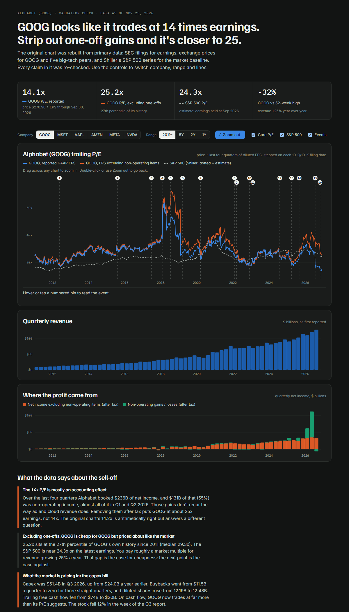

# Is GOOG actually cheap?

**Live page:** https://karenmkrtchyan.github.io/Trading_Research/goog-valuation/

This rebuilds a widely shared chart ("Alphabet (GOOG): Revenue vs. Trailing P/E, with S&P 500 baseline and key events") from primary data, and checks every claim in it. It also adds five big-tech peers and a P/E that leaves out one-off gains. Data runs through the week of Nov 25, 2026. This is an analysis of valuation data, not investment advice.



## Findings

| Measure (Nov 25, 2026) | Value |
|---|---|
| GOOG P/E, reported GAAP | **14.1x**, lowest weekly reading since 2011 |
| GOOG P/E, excluding non-operating items | **25.2x**, 27th percentile of its history since 2011 (median 29.3x) |
| S&P 500 P/E | **~24.3x** (Shiller; earnings held at Sep 2026) |
| GOOG vs 52-week high | **−32%** |
| GOOG trailing free cash flow | **$19.7B**, down from $73.6B a year earlier |

1. **The 14x P/E is mostly an accounting effect.** $131B of $236B trailing net income (55%) is non-operating income ($37.7B in Q1'26, $98.0B in Q2'26). Without it, after tax, GOOG trades at about 25x.
2. **Excluding one-offs, GOOG is cheap relative to its own history, but priced about like the market**, with revenue growing +24.7% year over year.
3. **The sell-off tracks the capex bill.** Capex went from $24.0B in Q3'25 to $51.4B in Q3'26. Buybacks have been $0 for three quarters and diluted shares are rising. GOOG fell 12% in the week of the Q3'26 report.
4. **The tech sell-off is uneven.** NVDA −36%, GOOG −32%, META −19%, AMZN −11%, MSFT −8%, AAPL at its high. AMZN's reported P/E is also flattered by non-operating gains, and its trailing free cash flow is negative.

## Corrections to the original chart

- Bard demo day: GOOG fell 7.4% (the chart's 7.7% is the GOOGL share class).
- The S&P 500 baseline uses Shiller's actual earnings through Sep 2026 instead of estimates from mid-2023 on.
- The dual y-axis is replaced by stacked panels on one time axis.
- Q3 2026 is added (a non-operating loss, the capex surge, zero buybacks).
- Confirmed as published: the 14.2x P/E, Q4'17 net income −$3.02B (P/E peak 64.4x), Q2'18 $3.19B, Q2'26 $112.19B including $97.98B non-operating, Q3'26 revenue $127.58B.

## Data and method

- **Earnings:** SEC XBRL company facts (data.sec.gov), as first reported. Q4 is derived as FY − (Q1+Q2+Q3). EPS is split-adjusted by filing date. Trailing P/E steps forward on each filing date.
- **Excluding one-offs:** removes "other income (expense), net" after tax (35% before 2018, 21% after). This is an approximation.
- **Prices:** weekly closes from Webull, converted from dividend-adjusted to split-only using SEC dividends per share, and checked against Alpaca split-only closes (median error ≤0.1%). Webull's GOOG closes for Nov 2010 to Mar 2014 were 2× too high (missing the 2014 class-C split adjustment); this is detected and fixed in `pipeline.py`.
- **S&P 500:** Robert Shiller's `ie_data.xls`, cross-checked against S&P Dow Jones Indices aggregates (±2–7%) and daily closes.
- **Verified in the Nov 26 review (previously listed as not verified):** Q3'26 missed on both lines (adjusted EPS $2.67 vs $3.02 expected, revenue $127.58B vs $128.22B; [CNBC](https://www.cnbc.com/2026/10/28/alphabet-googl-earnings-q3-2026.html)), and the ~$41B financing is $29.0B of debt plus $12.4B of stock issued in Q3 ([Q3 release](https://www.sec.gov/Archives/edgar/data/1652044/000165204426000080/googexhibit991q32026.htm), cash flow statement).

## Review notes (Nov 26, 2026)

Added after checking the page against Alphabet's filings, earnings call and press coverage. The same notes appear on the live page under "Review notes".

- **Confirmed against primary sources:** capex ($51.4B in Q3'26 vs $24.0B), zero buybacks in Q3 and the first nine months, other income (-$8.2B in Q3, +$98.0B in Q2), trailing free cash flow of $19.7B ([Q3 release](https://www.sec.gov/Archives/edgar/data/1652044/000165204426000080/googexhibit991q32026.htm), [Q3 call](https://abc.xyz/investor/events/event-details/2026/2026-Q3-Earnings-Call-2026-Ujou16CTw9/default.aspx), [Q2 release](https://www.sec.gov/Archives/edgar/data/1652044/000165204426000066/googexhibit991q22026.htm)).
- **Corrected:** diluted shares. The page said 12.19B to 12.48B, which was net income divided by EPS (net income includes preferred dividends since Q2'26). Reported diluted weighted-average shares are 12,203M in Q3'25 and 12,368M in Q3'26 (+1.4%). The core P/E moves from 25.2x to about 25.1x. `pipeline.py` still derives shares as net income / EPS, so the processed dataset and its verification log still show the old implied counts; the page text now uses the reported ones.
- **Blind spot, what the gains are:** the Q2 gain is a mark-to-market on SpaceX shares ($94.1B) and a private company widely identified as Anthropic ([Fortune](https://fortune.com/2026/07/22/anthropic-spacex-investments-google-earnings-biggest-ever-profit-quarter/)). It reversed to an $8.7B loss in Q3 and can swing again in Q4. Deferred income taxes rose from $0.9B to $27.8B because the gains are unrealized.
- **Blind spot, tax rate:** Alphabet's disclosures imply about 22% to 23% tax on these items, not a flat 21%. With the share fix, the core P/E would be about 24.8x. The conclusion (roughly 25x, near the market) holds.
- **Blind spot, baseline:** the 24.3x S&P 500 line uses Shiller as-reported earnings held flat after Sep 2026. A fund-level VOO trailing P/E is 21.6x ([StockAnalysis](https://stockanalysis.com/etf/voo/)), which would put GOOG about 17% above the market.
- **What would change the thesis:** 2027 capex guidance, Cloud growth vs capex, free cash flow turning positive, buybacks restarting, Q4 marks on SpaceX and Anthropic. Long-term debt rose from $46.5B (Dec 31, 2025) to $125.1B (Sep 30, 2026).
- See also the [watchlist valuation page](../watchlist-valuation/), which applies the same checks to a wider watchlist.

## Rebuild

```
python scripts/pipeline.py <raw_dir> data/dataset.json
python scripts/build_page.py data scripts/template.html index.html
```

`<raw_dir>` must contain the SEC company-facts JSON files (`alphabet_facts.json`, `google_facts.json`, `MSFT_facts.json`, …), the weekly price files (`<TICKER>_weekly.json`), `alpaca_monthly.json`, `ie_data.xls`, `sp-500-buyback.xlsx`, `PerformanceGraphExport.xls` and `sp500-pe-ratio.csv`. Those raw files aren't committed. `data/dataset.json` is the processed output the page is built from.
